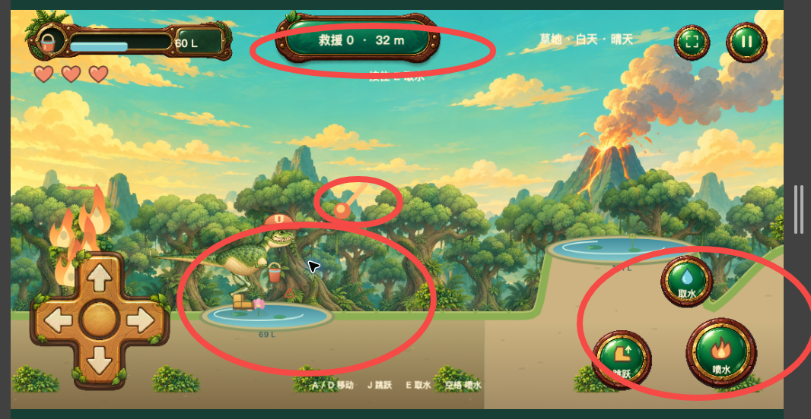
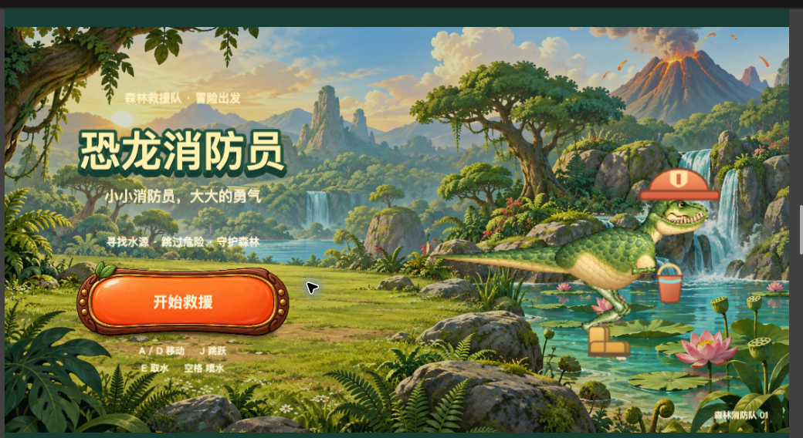

# 恐龙消防员：失败画面与持续修正

## 2026-10-14 火山底部外露

问题：火山贴图完整底边露出，像独立悬放的山。原图高度285，且草地树林透明度0.75、砂石地0.35，让远景山脚透出来。

按用户要求将火山整体放大至600逻辑像素（约2.1倍），以喷口为锚点，让山脚延伸到地面后；火山固定在天空之后、全部山林与地形之前的最远景层。树林恢复不透明遮挡，避免通过降低整层透明度区分地貌。烟与飞石仍来自同一喷口位置。修改已落代码，尚未进行新画面验收。

## 当日后续复盘（2026-10-13）

| 问题 | 原因与解决方案 | 状态 |
| --- | --- | --- |
| 瘦腿、嘴歪、帽靴分离，不像设计稿 | 改用用户认可的胖恐龙完整PNG，跑、舀水、倾桶分别出帧；保留源图并实测落脚点 | integrated / review-pending |
| 兔子浮空 | 透明边距与虚构池岸抬高65px叠加；去掉抬高，逐帧alpha脚底对齐地面 | integrated / review-pending |
| 兔鹿卡在岸边、建筑缝 | 岸内每帧反向造成震荡；按完整占地求连续安全步行区间，选择够宽出生段，边界停留再转向 | regression-passed |
| 鹿只是静态平移 | 补四帧实际蹄位变化，停留时不乱循环，步态与位移同步 | integrated / review-pending |
| 鸟不停乱飞 | 落燃烧树和落树即被蛇咬；过滤燃烧落点，停栖18–32秒，咬鸟冷却30–60秒 | regression-passed |
| 鳄鱼被水层切成横条 | root猜测与裁头错误；整身绘制，前景水层覆盖，不硬切身体 | integrated / review-pending |
| 鳄鱼攻击不明显、和恐龙重叠 | 游泳只播0/1帧，独立站起挥拳四帧；站位拉开+探身，0.66秒拳到位再命中，公共提示与扣心同步 | integrated / review-pending |
| 地面粗糙、背景/地貌接缝色差 | 原创草根土石纹理、边缘渐混、按世界坐标贴地形；地貌颜色连续过渡 | integrated / review-pending |
| 水塘、滩涂、深坑贴图浮在土上 | 美术、碰撞、脚点采用统一池岸/深度几何；完整贴图半径1.125r，留bank | integrated / review-pending |
| 滩涂与陷阱重合 | 后追加洞旁泥洼绕过校验；最终统一布局包括fallback，跨区块保留净距 | regression-passed |
| 掉坑像切掉角色 | 去硬clip，完整角色向中心下落、缩小、渐隐，阴影同步 | integrated / review-pending |
| 单跳越不过坑，洞顶无法躲蛇 | 二段跳上限2和水平延长；洞顶单向平台、走出落下，蛇接触按高度判定 | regression-passed |
| 水量条低于槽，加载条不贴合 | 读HUD原图实测槽坐标；弯曲加载条从connected dark cavity派生动态填充mask | integrated / review-pending |
| 开始前已加载，跑动未展示 | 首页仅封面，点击后加载引擎和素材直到POST_RENDER，恐龙按帧脚点沿槽跑 | browser-observed |
| 火势椭圆临时UI很丑 | 独立原创木框火势牌，实时数字/条填入原图空槽 | integrated / review-pending |
| 旧倒水曲线残留，像喝水 | 完整朝外倾桶帧，删除重复quadratic水流 | integrated / review-pending |
| 空桶/受击没有提示 | World事件队列+原创公共Toast，伤害优先、闪屏/震动/浮动−1心；旧淡出不能覆盖新消息 | integrated / review-pending |
| 独立飘动白点不明 | 大风的无形状ellipse粒子，删掉；不能未核查就猜成星星 | integrated |
| 昼夜仅亮度变化 | 独立日夜天空树林素材，过渡显示黄昏；烘焙星点和独立粒子须分辨 | integrated / review-pending |

最新规则覆盖旧记录：必须入池踩底舀水；池内倒水回灌、容量封顶、无灭火分并平息鳄鱼。鳄鱼仅舀水抽干那刻挥拳一次，文案“鳄鱼很生气，揍了恐龙”，雨天不攻击；完成后干池隐藏鱼鳄，取消旧干鱼蹦跳需求。雨补水、大火变小，多桶灭火保留进度，一处一分。

编排经验：并行出图用Promise.allSettled，避免一个失败丢弃其余正在生成的结果。出图不等于接引擎，接引擎不等于用户当前页面已刷新。用户授权舰队后按renderer、model/characters、bootstrap/style/feedback划分文件，交接共享几何，避免各自猜比例。源PNG、回执、SHA256保留在项目data；技术通过与用户认可分列。

最后规则回归31/31通过。用户最后要求停止追加验证，直接推送并关闭服务；所有新美术仍为review-pending，不能标记user-accepted。

日期：2026-10-13。项目：`/Users/yuanjing/Desktop/dinosaur-firefighter`。用户要求每项优化进入经验仓库，本案例持续维护；没有用户认可前不能标记已验收。

## 已拒收的版本

v1 网页面板不符合游戏 UI。v2 虽接入 Phaser、独立图案、蒙皮和动作，但整体画面仍被用户拒收。资源生成、透明通道和逻辑测试通过都不能替代视觉放行。

## 优化台账

| ID | 用户反馈/实际问题 | 处理与检验方法 | 状态 |
| --- | --- | --- | --- |
| DF-01 | 网页面板，不像游戏 | Phaser 场景、主题源件和独立动态文字；在游戏里看组合 | implemented / user-rejected-v2 |
| DF-02 | 四个独立圆方向键不对 | 读取 worm-run 的整体十字盘和指针独立状态，复用原图与热区方案 | implemented / review-pending |
| DF-03 | 水池小、没有完整状态 UI、鳄鱼装不下 | 按鳄鱼全长检验水体尺寸，状态栏与容量/恢复绑定，绘制真实池岸和水面 | in-progress |
| DF-04 | 水池紧贴火灾、坑洞等对象 | 生成时按对象占地而不是中心点检查间距；保存随机样本回归 | technical-passed / visual-pending |
| DF-05 | 火是一团独立火点，不像物体起火 | 火焰锚到枝冠、灌木、屋顶/窗口，大小依火势、摇曳依风；火星点燃物体 | implemented / visual-rework |
| DF-06 | 看不到火山，却在喷发 | 火山独立可见，真实喷口与轨迹起点一致；移动镜头和不同地貌都检查 | in-progress |
| DF-07 | 房屋悬空 | 以源图实际脚点和支撑地形放置，不能猜 95% 底边；坡面需明确支撑平台 | in-progress |
| DF-08 | 底部大块空白 | 地面、前景、镜头和 HUD 在同一实际画面定尺度；不用补几团草掩盖留白 | in-progress |
| DF-09 | 取水不弯腰，洒水不是倾桶 | 取水、待机、移动、倾桶分别定义姿势；骨长不变、脚有支撑、桶口与水流对齐 | in-progress |
| DF-10 | 喷水键却是火焰图标 | 功能图标体现动作：蘸桶取水、倾桶倒水；不能按危险元素选择图标 | in-progress |
| DF-11 | 救援计数拿按钮壳充当 HUD、开始页粗糙 | 首页专门构图与标题；计数专用徽章而非按钮复用，检查字体尺寸和信息层次 | in-progress |
| DF-12 | 地貌、天气、昼夜与无限地图 | 分块生成与回收；天气和时间由玩法时钟驱动，暂停冻结 | technical-passed / visual-pending |
| DF-13 | 火星导致树/灌木/房屋/山洞随机着火 | 落点绑定可燃物 ID，完成飞行才点燃；伤害和起火分别结算 | technical-passed / visual-pending |
| DF-14 | 鳄鱼没有可见表现 | 部分水池潜伏，鼻子/尾尖为线索；蘸水触发可观察的露头与反应窗口 | technical-passed / visual-rework |

## 可复用经验（当前为失败教训）

- UI 美术质量在完整画面中判断。把好看的独立背景、按钮、角色拼在一起，并不意味着形成了同一套美术。
- 交互图标必须表达玩家要做的动作。灭火按钮画火焰会表达相反意义；取水按钮只有水滴也不能解释蘸桶。
- 角色资产换皮不能省略新交互动作。行走骨架可复用，但取水要真的弯腰，倾桶要真实转桶，水流始于桶口。
- 放置脚点要由源件实测得到；连续坡面还要检查建筑完整底边是否获得支撑。图片尺寸比例不是脚点。
- 水池占地由世界尺度和鳄鱼完整轮廓决定，不能仅把椭圆半径略增大。
- 被遮挡的火山不能只用火星说明存在；玩家应能看见喷口，且轨迹来自那个喷口。
- 先查同仓库实际源码与素材，确定四向十字盘/摇杆究竟是哪一种，再实现输入。键盘和每根手指各有状态。
- 保护时间与伏击预警是规则，不应每帧重置计时，让持续取水无意中变成无敌。

## 验收证据

当前只有失败截图和规则回归，不能标为用户认可。后续每项记录源码/源图路径、哈希、同状态同视口的前后截图、实际动作观察和未通过项。项目内 `art/qa/` 保存过程；本页记录能被复用的结论。
